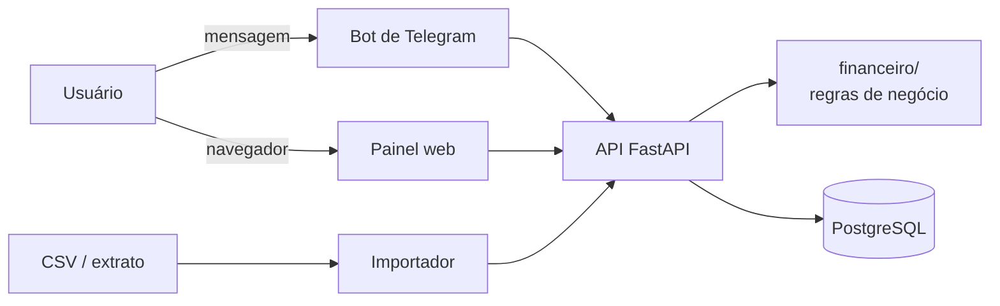

# Controle financeiro para autônomos e MEIs

[](https://github.com/Diego-Carvalho-1901/sistema-controle-financeiro/actions/workflows/ci.yml)

App em Python que separa o dinheiro do negócio do dinheiro pessoal e mostra,
sem planilha, quanto o negócio realmente lucrou no mês.

> **Estado atual:** ferramenta de linha de comando que lê CSVs e gera um
> relatório. Banco de dados, API e bot de Telegram estão no
> [roteiro](#roteiro), em desenvolvimento.

## O problema

Quem trabalha por conta própria costuma usar a mesma conta para tudo: a
farinha do bolo, o aluguel e o cinema saem do mesmo lugar. No fim do mês fica
difícil responder perguntas simples:

- Quanto o negócio faturou e quanto gastou para produzir?
- O negócio deu lucro ou eu só estou trocando dinheiro de bolso?
- Quanto sobrou para mim, tirando o que é do negócio?

Planilhas resolvem, mas exigem disciplina que pouca gente mantém. A ideia do
projeto é registrar cada movimentação do jeito mais simples possível (no fim,
uma mensagem no Telegram como `vendi 3 bolos 45`) e deixar o app fazer as
contas.

## Para quem

- **Autônomos e MEIs** que vendem produtos ou serviços: confeiteiras,
  costureiras, técnicos, freelancers.
- Pessoas que **não querem aprender um sistema contábil**, só saber se estão
  ganhando dinheiro.

Os dados de exemplo em [`dados/`](dados/) seguem esse perfil: uma confeitaria
caseira que vende bolos e doces e também registra os gastos pessoais.

## O que já funciona

- **Leitura de CSV** em três formatos, reconhecidos pelo cabeçalho (veja
  [Formatos de CSV](#formatos-de-csv)), inclusive o CSV de vendas do projeto
  irmão [analisador-vendas-csv](https://github.com/Diego-Carvalho-1901/analisador-vendas-csv).
- **Vários arquivos no mesmo relatório**: `python main.py a.csv b.csv c.csv`.
- **Negócio x pessoal**: cada lançamento pertence a uma conta (`negocio` ou
  `pessoal`). O relatório mostra faturamento, custos, lucro e margem do
  negócio, e o saldo pessoal separado.
- **Análises gerais**: receitas, despesas e saldo; resumo por mês; totais,
  percentuais e ranking por categoria; maior e menor movimentação; médias;
  alerta de categorias com alta concentração de gastos.
- **Dinheiro com `Decimal`**, não `float`, para não perder centavos em somas.
- **Erros de dados com mensagem clara** (arquivo inexistente, valor, data,
  tipo ou conta inválidos), indicando a linha do problema.
- **Testes automatizados** com pytest e **CI** no GitHub Actions rodando ruff
  e pytest em todo pull request.

## O que vem por aí

O plano completo, com critérios de pronto, está nas [issues](#roteiro). Em
resumo:

| Fase | Entrega |
|---|---|
| 2 — Backend | Banco de dados (SQLAlchemy + Alembic), importador de CSV para o banco, API REST com FastAPI, resumos com agregações em SQL, Docker com PostgreSQL |
| 3 — Bot | Bot de Telegram que entende frases livres (`gastei 30 almoço`), comandos `/resumo`, `/desfazer` e `/meta`, categorização automática, resumo semanal e alerta de meta, deploy com backups |
| 4 — Produto | Importação de extratos de bancos reais, painel web com gráficos do mês, métricas de uso |

## Arquitetura

### Hoje

O código fica no pacote `financeiro/`, com uma responsabilidade por módulo. O
fluxo é linear: ler, calcular, formatar.

```text
CSV(s) ──► leitura.py ──► list[Lancamento] ──► calculos.py ──► relatorio.py ──► terminal
                              (modelos.py)
```

```text
sistema-controle-financeiro/
├── main.py                 # linha de comando (argparse): recebe os CSVs e imprime o relatório
├── financeiro/
│   ├── modelos.py          # dataclass Lancamento: data, valor, tipo, categoria, descrição, conta
│   ├── leitura.py          # reconhece o formato do CSV e converte cada linha, validando os dados
│   ├── calculos.py         # funções puras: somas, médias, percentuais, lucro do negócio
│   └── relatorio.py        # monta o texto do relatório a partir dos cálculos
├── dados/                  # CSVs de exemplo (pessoal, negócio e vendas)
├── tests/                  # um arquivo de teste por módulo
└── .github/workflows/ci.yml
```

As regras de negócio ficam em funções puras (`calculos.py`), que recebem
lançamentos e devolvem números, sem ler arquivo nem imprimir nada. Isso deixa
os testes simples e permite reaproveitar as mesmas funções quando a entrada
deixar de ser um CSV e passar a ser o banco de dados.

### Para onde vai



A API vira o único ponto de entrada para os dados: bot, painel e importador
falam com ela, e ela usa as mesmas regras de negócio que o relatório usa hoje.

## Stack

| | Hoje | Planejado |
|---|---|---|
| Linguagem | Python 3.12, só biblioteca padrão (`csv`, `decimal`, `datetime`, `argparse`, `dataclasses`) | |
| Qualidade | pytest, ruff (lint e formatação), GitHub Actions | |
| Dados | Arquivos CSV | SQLAlchemy, Alembic, SQLite (dev) e PostgreSQL (produção) |
| Interfaces | Linha de comando | FastAPI, bot de Telegram, painel web |
| Infra | | Docker e docker-compose |
